# Architecture diagrams

Every diagram on this page renders natively on GitHub (Mermaid). Names, states, tool counts
and step ids are the repository's actual values — if you rename a module, update the diagram.

Contents: 1. [End-to-end investigation pipeline](#1-end-to-end-investigation-pipeline) ·
2. [Harness state machine](#2-harness-state-machine) · 3. [The path of one tool call](#3-the-path-of-one-tool-call) ·
4. [Evidence and finding model](#4-evidence-and-finding-model) · 5. [MCP topology](#5-mcp-topology) ·
6. [Investigation sequence](#6-investigation-sequence) · 7. [Attribution decision flow](#7-attribution-decision-flow) ·
8. [Package dependencies](#8-package-dependencies) · 9. [Stage 2 extension](#9-stage-2-research-workflow-realised-in-030) ·
10. [CI and the release gate](#10-ci-and-the-release-gate) · 11. [LLM, RAG, ML and evaluation (0.6.0)](#11-llm-rag-ml-and-evaluation-060) ·
12. [Paper trading and the R5 real-data path (0.7.0)](#12-paper-trading-and-the-r5-real-data-path-070) ·
13. [Policy and approval flow (0.8.0)](#13-policy-and-approval-flow-080) ·
14. [Audit chain and external anchor (0.8.0)](#14-audit-chain-and-external-anchor-080) ·
15. [Execution package (0.8.0)](#15-execution-package-080) ·
16. [Critic statement checks (0.9.0)](#16-critic-statement-checks-090) ·
17. [Local model evaluation and replay (0.9.0)](#17-local-model-evaluation-and-replay-090) ·
18. [Harness mixins and the run journal (0.9.0)](#18-harness-mixins-and-the-run-journal-090) ·
19. [Hybrid retrieval and the judge gate (0.9.0)](#19-hybrid-retrieval-and-the-judge-gate-090) ·
20. [Study E1 (0.9.0)](#20-study-e1-090)

## 1. End-to-end investigation pipeline

Solid arrows are data flow. The LLM appears only where reasoning happens (planning,
critique, narrative); every number on the path comes from `ceap.analytics`.

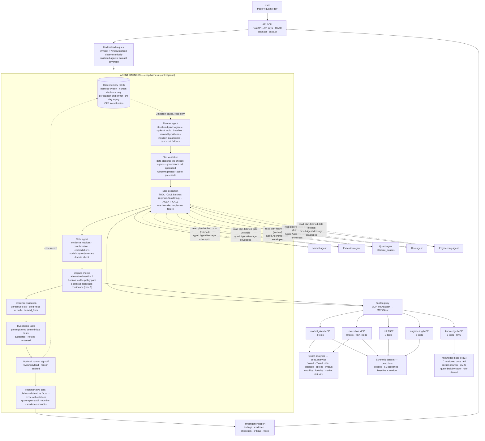

## 2. Harness state machine

`ceap/harness/state_machine.py` — `TRANSITIONS` is the entire legal graph; anything else
raises `InvalidTransition`. `FAILED` and `CANCELLED` are reachable from every non-terminal
state.

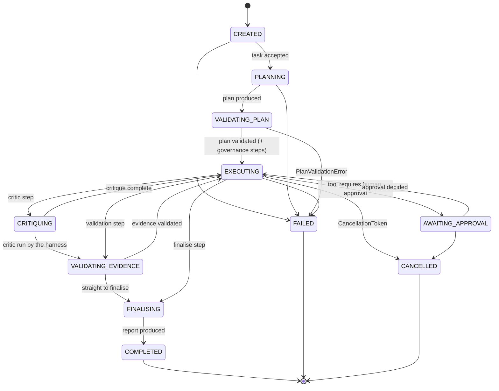

## 3. The path of one tool call

`StepExecutor.execute_tool` is the only way a tool runs — for plan steps and for agents'
own calls alike (`HarnessToolInvoker`).

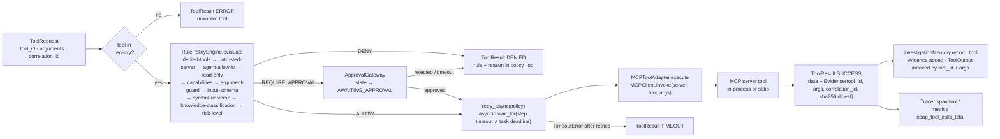

## 4. Evidence and finding model

Every claim in a report is a `Finding`; every `Finding` cites `Evidence` ids that must resolve
in `InvestigationMemory` or the finding is dropped at `VALIDATING_EVIDENCE`.

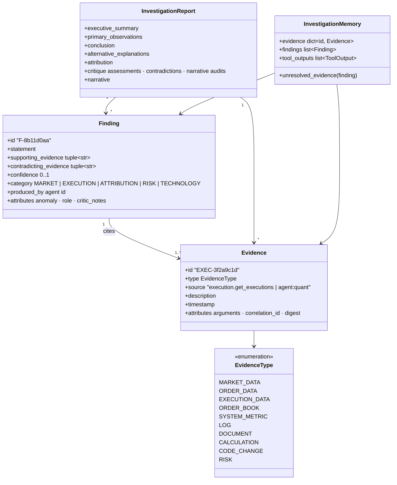

## 5. MCP topology

One `MCPServerDefinition` per server; the same object answers in-process calls and is exported
to a real `FastMCP` server over stdio. Tool schemas are derived from Python signatures, so the
two representations cannot drift.

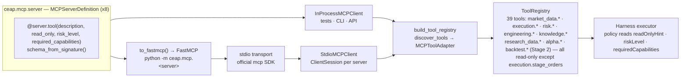

## 6. Investigation sequence

The canonical plan for the MVP question, as the deterministic planner emits it (a real model
produces the same shape; unknown tools are stripped).

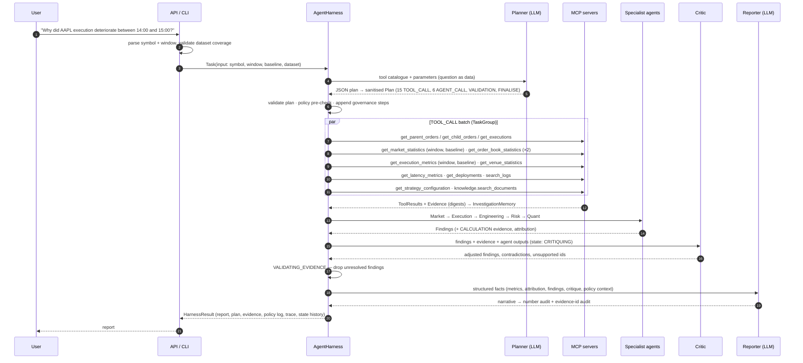

## 7. Attribution decision flow

`ceap.analytics.attribution.attribute_causes` — thresholds in `Thresholds`, materiality at
0.35. The two guards on the right are the ones the evaluation suite forced into existence.

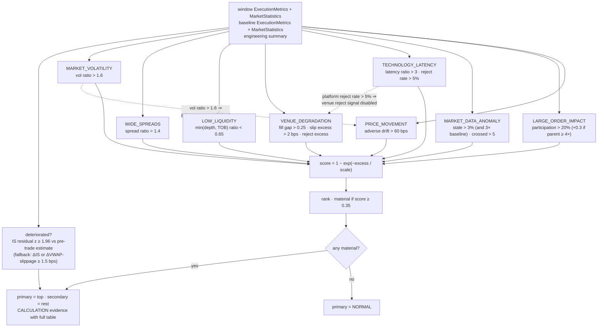

## 8. Package dependencies

Arrows point from a package to what it imports at module level (imports inside functions, used to
break cycles, are not shown). Checked against the source for 0.9.0 with
`grep -rhoE '^(from|import) ceap\.[a-z_]+' src/ceap/<package>`. `domain` imports only the
dependency-free leaf `ceap.util`; the LLM SDK, MCP SDK and FastAPI are each confined to one
package. Two edges are less clean than the layering suggests and are shown as they are:
`analytics.tca_aggregate` imports `ceap.data`, `ceap.ml` and `ceap.policy` (the monthly TCA report
uses the pre-trade model and runs its own approval step), and `rag.hybrid_eval` imports `ceap.eval.stats`.

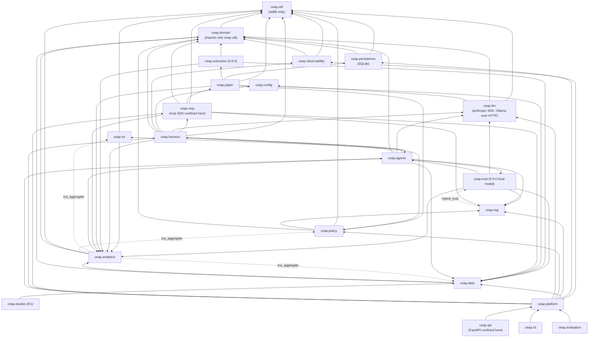

## 9. Stage 2: research workflow (realised in 0.3.0)

The research workflow runs on the same harness, policy engine, approval gateway and evidence
model. Tool calls come first (their outputs are cached evidence), the agents interpret them, the
critic computes the deterministic assessment, and the harness owns the governance tail: proposal
approval, then - only when requested and only for a principal with `trading:execute` - a second
approval and the single non-read-only tool, `execution.stage_orders` (paper orders).

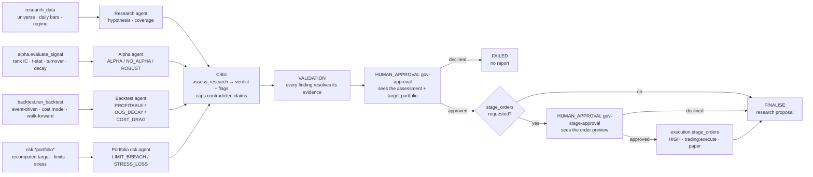

## 10. CI and the release gate

Added in 0.4.0 (Round R0). Every PR runs the jobs on the left; a release happens only from a tag on
a commit whose checks are all green, and the gate re-checks versions, CHANGELOG, banned words and
licences before anything is built.

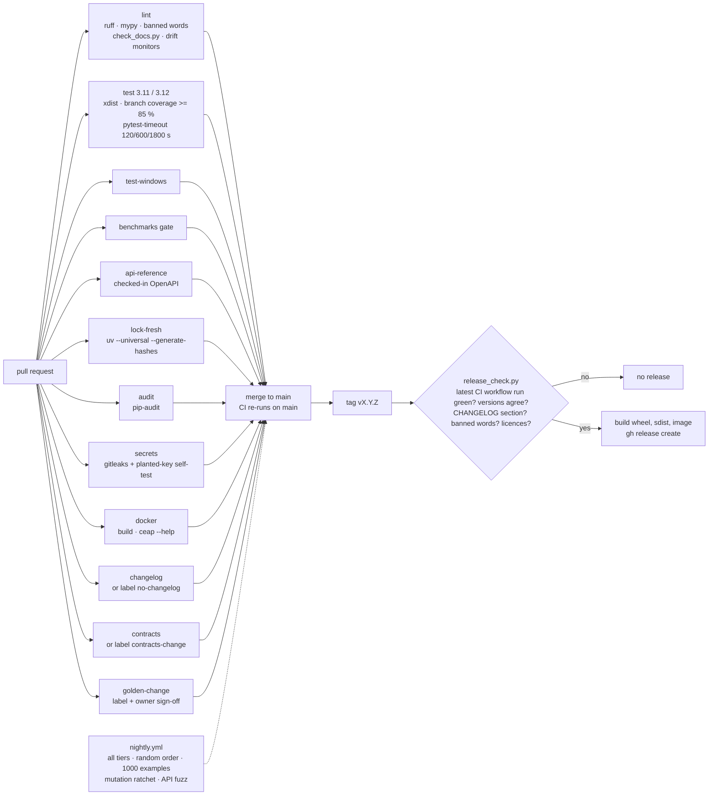

## 11. LLM, RAG, ML and evaluation (0.6.0)

Rounds R3A, R3B, R3C, R2B and R3E. The model proposes; code validates, computes and audits. Every
model-dependent path is exercised offline (mock client, cassettes, wire contract tests); no live
model call was made (D15), so live quality is UNKNOWN / NOT RUN LIVE.

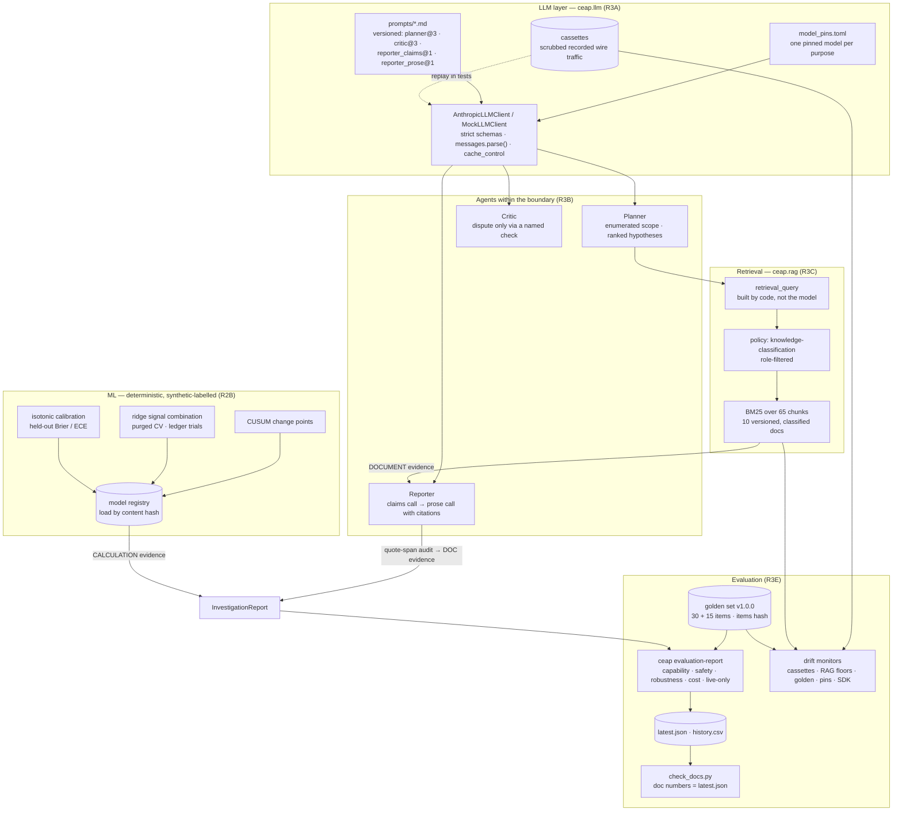

## 12. Paper trading and the R5 real-data path (0.7.0)

Today only the synthetic branch runs, daily since the owner enabled the scheduled job (forward
record from 2026-11-09). The Stooq branch is written but disabled: `config/paper.json` stays on the
synthetic feed, no Stooq data is in the repository, and the feed refuses every row up to 2025-12-31
so the R5 pseudo-holdout stays unspent. The R5 study stopped at its coverage gate twice (VOID; the
0.7.1 v2 attempt on Stooq also failed it).

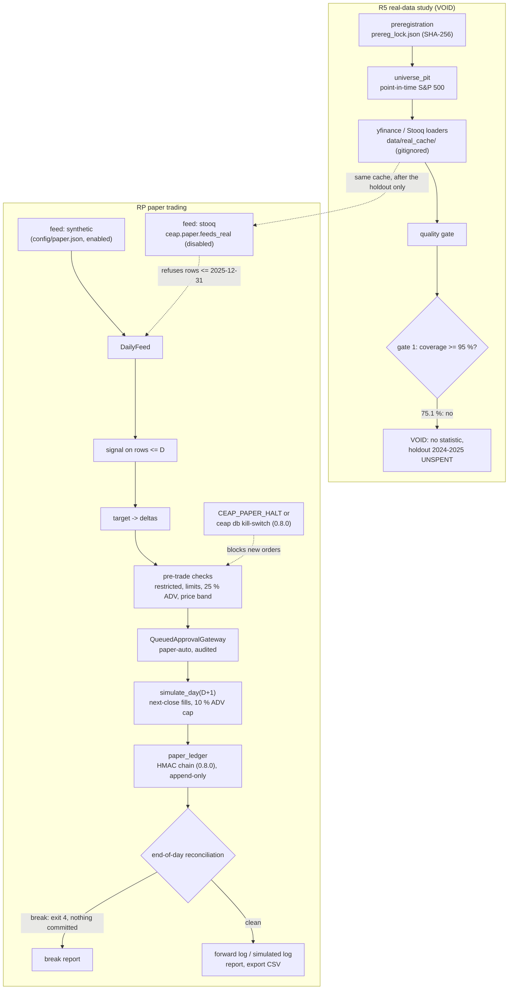

## 13. Policy and approval flow (0.8.0)

`RulePolicyEngine` runs its rules in this order (`src/ceap/policy/engine.py`); the first DENY wins, then
REQUIRE_APPROVAL, otherwise ALLOW. Since 0.8.0 a HIGH-risk tool always needs a human approval, an
admin cannot decide one, and four-eyes compares named persons (API keys mapped with
`subject=NAME`), not keys. The gateway re-checks the content hash of the exact arguments after the
decision.

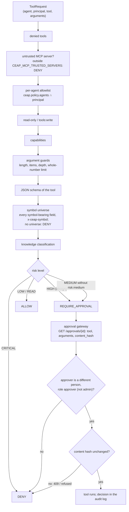

## 14. Audit chain and external anchor (0.8.0)

Each audit row and paper-ledger row links to the previous one with HMAC-SHA256 under
`CEAP_AUDIT_HMAC_KEY`, which never lives in the database. Rows written before migration 0004 stay
plain SHA-256 as a sealed legacy prefix. An anchor file committed to git (optionally with an
OpenTimestamps proof of its `.sha256` sidecar) lets `verify-chain` catch a rewritten or truncated
chain even by someone who holds the key.

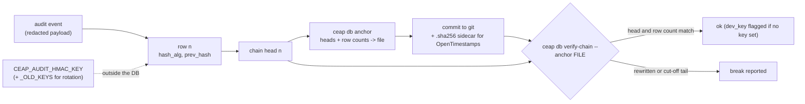

## 15. Execution package (0.8.0)

`ceap.execution` (guide: [execution/execution.md](execution/execution.md)), a simulator library, not used by the default paper book, runs a parent order
through a simulated limit order book. Everything here is synthetic; nothing routes a real order.

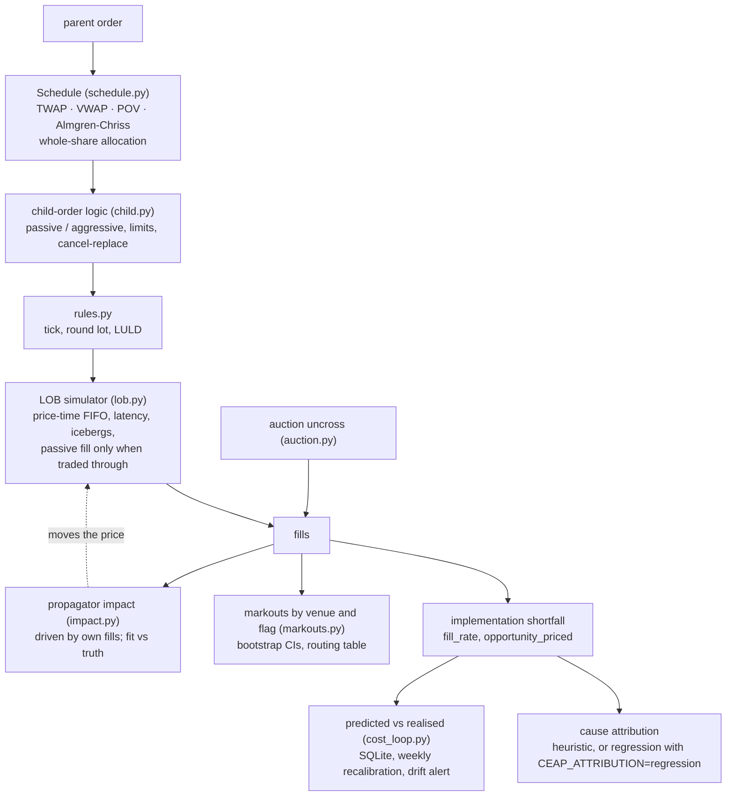

## 16. Critic statement checks (0.9.0)

`ceap.agents.critic_checks.check_statement` runs on every finding after the evidence checks; each
flag caps confidence (`CHECK_CAPS` in `ceap/agents/critic.py`) and is recorded in
`assessment["flags"]`.

The three checks are independent: one finding can collect more than one flag.

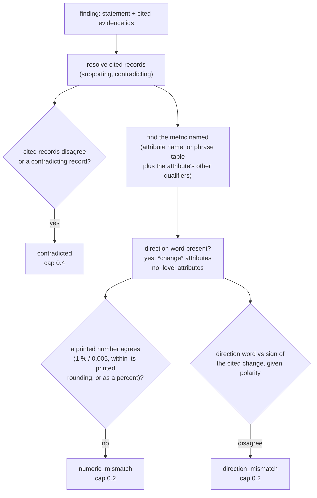

## 17. Local model evaluation and replay (0.9.0)

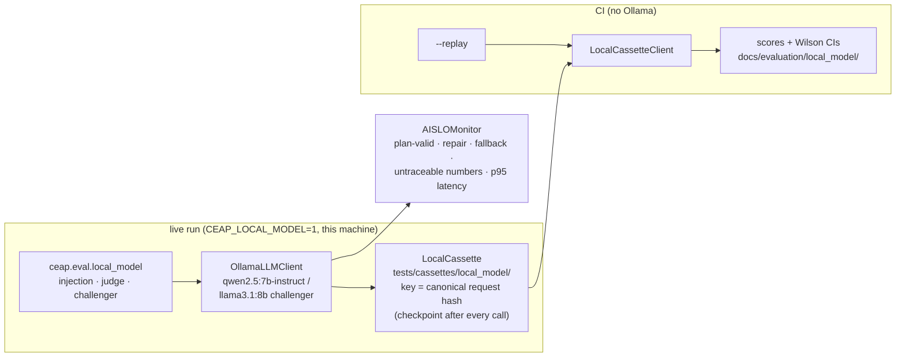

## 18. Harness mixins and the run journal (0.9.0)

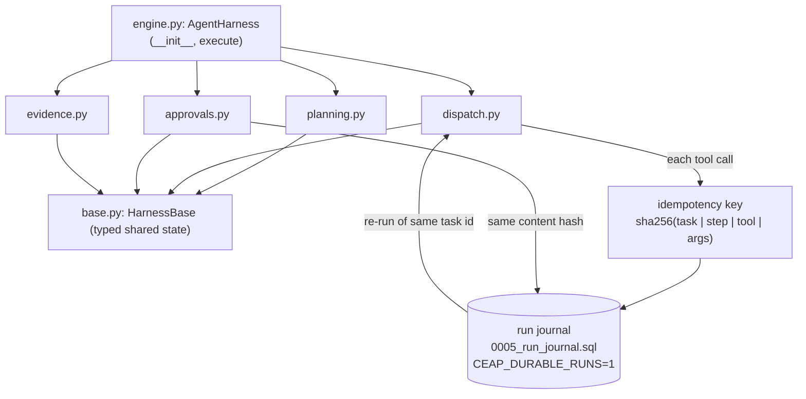

The approval sweep (`ceap.api.loopmon.approval_sweeper`, interval `CEAP_APPROVAL_SWEEP_S`) expires
pending approvals older than `CEAP_APPROVAL_TIMEOUT_S`, so a restart cannot leave a step waiting
forever.

## 19. Hybrid retrieval and the judge gate (0.9.0)

Two gates fixed before their runs. Retrieval: BM25 is the default; `HybridRetriever` is opt-in
because the reranker needs a model at query time. Judge: a rubric dimension is used only when
Cohen's kappa against a hand-labelled reference exceeds 0.6 (`KAPPA_BAR` in `ceap/eval/judge.py`);
the committed calibration enables `hedged` only (`docs/evaluation/local_model/judge_calibration.json`).

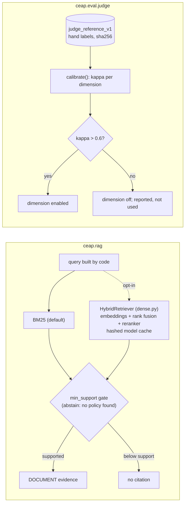

## 20. Study E1 (0.9.0)

`ceap.studies.industry_momentum` refuses to run when the preregistration hash differs from
`prereg_lock.json`, and refuses a second holdout opening. Guide: [research/e1/README.md](research/e1/README.md).

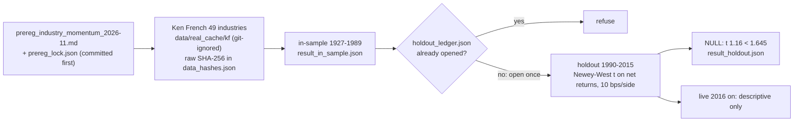
