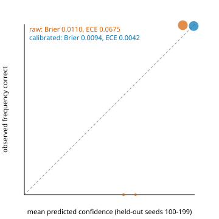

# Machine learning in CEAP (R2B)

Every model here is fitted to **synthetic data only** and says so: each card, each output and each
piece of `CALCULATION` evidence carries the label `fitted to synthetic generator <hash>` (or
`calibrated to ...`), where `<hash>` is `ceap.ml.registry.generator_hash()`, a content hash of the
generator sources (`data/synthetic.py`, `scenarios.py`, `historical.py`, `generator_params.py`,
`research_scenarios.py`). If the generator changes, the hash changes and the models must be refitted:

```bash
python scripts/train_ml_models.py
```

Models live in `data/models/<name>-<model_hash>.json` (card plus parameters) and are loaded by hash;
the loader recomputes the hash and refuses a mismatch. Cards: [model_cards.md](model_cards.md).

## 2B.1 Change-point detection (`ceap.ml.anomaly`)

Seven per-minute features (gateway p50 and p99 ack latency, rejects, router latency and CPU, feed
gaps, quote rate) are turned into robust z-scores against a 60-minute reference (median, 1.4826 x
MAD, with a scale floor per feature). A two-sided CUSUM with allowance `k = 1` alarms when it
crosses `h`. The onset is the start of the PELT segment containing the alarm (L2 cost, penalty
`2 ln n`), falling back to the CUSUM's last zero. The output names the feature, its direction, the
level before and after, the onset and alarm minutes, and the deployment within 30 minutes before
the onset.

`h` is fitted by `tune_threshold`: the lowest expected cost per session, at 30 analyst-minutes per
false alarm and 10 per minute of incident delay (incident prior 5 %), subject to the 95 %
Clopper-Pearson upper bound of the per-session false-alarm rate being at most 1/20 (ARL0 of at
least 20 sessions). Calibration seeds: 300 clean sessions, 100 T06-like (x10 latency), 100 mild
(x1.3). Result: `h = 11`, 0/300 false alarms (95 % upper bound 1.2 %), mean delay 1.8 minutes.

Held-out acceptance, `tests/unit/ml/test_anomaly.py` (`slow`):

| Check | Seeds | Requirement |
|---|---|---|
| ARL0 on clean sessions | 500 (30 000 to 30 499) | at most 25 false alarms (ARL0 >= 20) |
| T06 onset accuracy | 200 (20 000 to 20 199) | onset within 2 minutes in >= 190 |

The agents consume it as extra evidence: the engineering agent adds a change-point finding on
technology features and the market agent one on feed features. Neither adds an `anomaly` tag, so
the deterministic attribution is unchanged. TCA consumers can call `anomaly_score(points)`.

**Deviation.** The plan asks for onset "within 2 minutes of the planted deployment". The generator
records the T06 deployment at 13:52 but starts the latency regime at the window start, 14:00, and
`data/synthetic.py` belongs to the R2T lane. The test therefore measures the onset against the
planted regime change (14:00), and the finding reports the lag to the deployment ("8 minutes after
deployment CHG-40388").

The fast sweeps call the generator's own engineering-metric law (`SyntheticMarketGenerator._engineering`)
without simulating quotes and orders, which is about 100 times faster. A test checks a fully
generated T06 dataset gives the same 14:00 onset.

## 2B.2 Signal combination (`ceap.analytics.ml_signals`, D12)

Ridge, no intercept, of the 21-day cross-sectionally demeaned forward return on the three z-scored
library signals, pooled over names and dates. The in-sample dates with a label are
`start <= t <= in_sample_end - 21`, so no in-sample label reads an out-of-sample price.

**Purged, embargoed walk-forward CV.** The label dates are split into six contiguous blocks; fold
`j = 1..5` tests on block `j` and trains on earlier dates with `t + h + embargo < start(test)`
(h = 21, embargo = 5). Each penalty in `{1, 10, ..., 1e5}` and each single signal is one trial in
the trial ledger, scored by the per-day Sharpe of a rank-weighted, dollar-neutral book (rebalanced
every 21 days, gross of costs) over the concatenated test blocks. The ridge is refitted on every
label date with the best penalty. Its out-of-sample deflated Sharpe ratio is reported next to each
single signal's, all deflated by the same ledger count and cross-trial variance.

PROMOTE (for the combination) means an out-of-sample deflated Sharpe probability of at least 0.95.
On the null set the rate over 200 seeds must not be significantly above 5 % (Clopper-Pearson lower
bound <= 5 %, point rate <= 10 %). That check is the `nightly` test; a 40-seed smoke test runs as `slow`.

No gradient boosting and no meta-labeling (D12).

The MCP tool `alpha.combine_signals` exposes it. The alpha agent runs it when the task input has
`combine_signals: true` (the request field is a platform change, left as a patch for integration).

## 2B.3 Dynamic leakage tests (`ceap.analytics.leakage`)

* **Perturbation:** replace every input row after `t` with a fresh random path. Outputs at rows
  `<= t` must be bit-identical.
* **Shuffled labels:** rebuild prices from time-shuffled daily returns, recompute feature and label,
  and require `|t(mean rank IC)| <= 4`. A causal feature has no edge on a shuffled panel; a feature
  that reads the label period keeps one.

Wired in `tests/unit/analytics/test_leakage.py` for every library signal and every z-scored ridge
feature. A planted one-day look-ahead fails both, and a full-sample normalisation fails the
perturbation test. `test_ml_signals.py` also checks that changing every out-of-sample price leaves
the fitted ridge bit-identical, and, as a control, that labels allowed past the in-sample end would
move it.

## 2B.4 Confidence calibration (`ceap.analytics.calibration`)

The engineering change-point finding's raw confidence (from the CUSUM peak) is mapped by isotonic
regression fitted on seeds 0 to 99, and judged by Brier and ECE (10 bins) on seeds 100 to 199.
Each seed has eight sessions, two clean and six at latency x1.1 to x10. The outcome is "real regime
change and onset within 5 minutes". The map ships only if the held-out calibrated Brier is no worse
than the raw Brier. `BaseAgent.calibrated(key, raw)` applies a shipped map and returns raw otherwise.
Other agents' confidences remain heuristic and are now documented as such.



Held-out numbers: see [reliability_table.md](reliability_table.md) and the card.

## 2B.5 Registry, reproducibility, drift (`ceap.ml.registry`)

* `model_hash` is the content hash of `{name, kind, params}` with floats rounded to 8 decimals, so
  last-bit BLAS differences across OS or thread count do not change a model's identity.
* `nightly`: `test_ridge_reproduces_the_card_across_thread_counts_and_os` refits the ridge in
  subprocesses with 1 and 4 BLAS threads and compares with the stored card (rtol 1e-6, atol 1e-8),
  on whatever OS runs the nightly job (the card was fitted on Windows).
* Drift: cards hold decile references of their input features. `ModelRegistry.check_drift` computes
  PSI and warns (`DriftWarning`) above 0.25.
